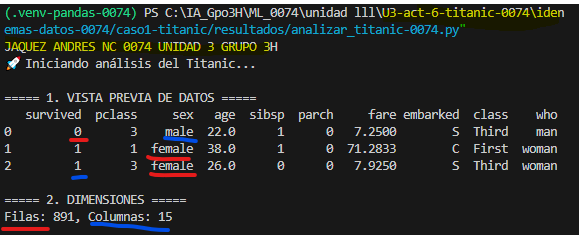
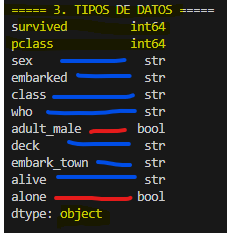
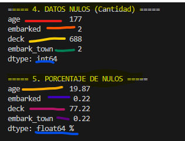
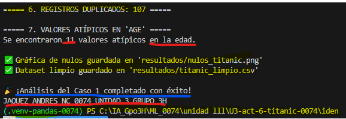
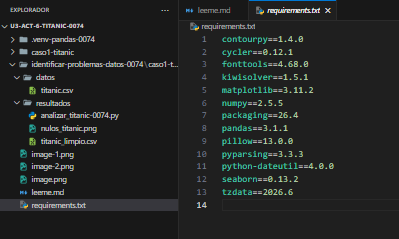

# 🕵️‍♂️ Práctica: Identificación de Problemas en los Datos
# JAQUEZ ANDRES NC 0074
> **⏱️ Duración:** 2 horas  
> **🎯 Nivel:** Cero a principiante  
> **🤖 Área:** Machine Learning (Data Cleaning)  
> **💻 Herramientas:** Python, VS Code, Pandas, NumPy, Seaborn  
## JAQUEZ ANDRES NC 0074 UNIDAD 3 GRUPO 3H
---

## 🎯 Propósito de la Práctica
Que los estudiantes aprendan a revisar conjuntos de datos (*datasets*) e identifiquen los problemas más comunes que pueden arruinar el entrenamiento de un modelo de Machine Learning.

Trabajaremos con dos escenarios reales:
1. **Caso 1: Pasajeros del Titanic** 🚢 (Detección de problemas reales: nulos, duplicados, tipos y atípicos).
## JAQUEZ ANDRES NC 0074 UNIDAD 3 GRUPO 3H

## ===== 1. VISTA PREVIA DE DATOS =====

## 2. TIPOS DE DATOS

## 3. DATOS NULOS Y SU PORCENTAJE

## 4. 

## IMAGEN GRAFICA CREADA 

## ESTRUCTURA Y ARCHIVOS CREADOS

## REQUERIMIENTOS 
